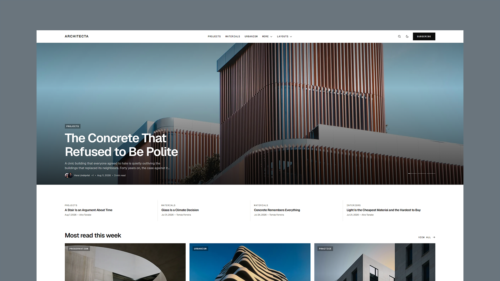

# Architecta - Astro Architecture Journal Theme

[](https://architecta.xocoweb.workers.dev/)

[](https://astro.build/)
[](https://tailwindcss.com/)
[](https://www.typescriptlang.org/)
[](./LICENSE)

**Live preview:** https://architecta.xocoweb.workers.dev/

Architecta is an Astro theme for architecture publications, studio journals, and design writing. The interface is strictly black and white — the whole palette is one neutral ramp with no hue anywhere, so links, focus, and active state read through weight and contrast instead of colour. Photography ships in full colour on top of it, and an optional monochrome mode desaturates every photograph on the site from a single token, so a colour cover dropped into a post can land grayscale without anyone editing the file. Every corner is square, structure comes from hairlines and mono capitals rather than from fills and chips, and the front page runs on a near-full-bleed track with a deliberately small gutter — a full-height lead, a ruled digest, and ruled rows and rails beneath it. Sections, navigation, featured stories, and SEO defaults all come from a small set of config files, so a publication can be renamed and re-scoped without editing components. Content is plain Markdown validated by Astro content collections, and the output is static: fast pages, crawlable articles, and no framework islands to hydrate.

## Features

- Near-full-bleed front page on a single shared track: a full-height lead slideshow with clickable progress ticks, a four-up ruled digest, rails for most-read and a section spotlight, a full-width long-read split, a four-up latest grid with two compact indices beside it, an ink statement band, section tiles, and ruled editorial rows
- One container for the whole site, so the header, footer, and every page section align on the same measure
- Optional monochrome media pipeline: photography ships in colour, and one filter token switches covers, tiles, hero slides, thumbnails, portraits, and images in article prose to grayscale — with a hover contrast lift and an ink wash over cover photography — without touching a single image file
- Zero-radius design system — the radius tokens are kept but set to `0`, so softening the whole theme is a four-line change
- Bare glyph controls: no chips, no outlines, no glass pills; arrows step forward on hover and icon buttons fade
- Scroll-snap rails that page horizontally on small screens and collapse into a plain grid on large ones — no carousel library
- Article pages with an 820px reading column, a reading-progress bar, share and copy-link actions, an author box, and a related rail
- Four story layouts chosen per post with one frontmatter field — a type-first standard head, an edge-to-edge banner strip, a full-bleed cover that carries the headline, and an immersive opening that fills the viewport with the photograph and rides the header on top of it — plus an optional header menu that previews all four
- Dynamic section pages with configurable featured, grid, and editorial list layouts
- Tag, author, archive, article, RSS, robots, and 404 pages
- Built-in client-side search with a keyboard-friendly command palette that opens as an empty field and shows results only once you type, plus a dedicated results page
- Markdown content powered by Astro content collections, with dual light/dark syntax-highlighted code blocks (plus a copy button), styled lists, rule-marked blockquotes, and captioned figures
- Coauthored bylines — add `coauthors` to a post and every name gets a round portrait in the stacked byline, an archive page, and an author box; cards count the extra names so the meta row stays one line
- Frontmatter validation for titles, excerpts, sections, dates, authors, coauthors, tags, covers, trending, and drafts
- Read time calculated from the post body at build time, at a configurable reading speed — nothing to maintain by hand
- Central site, navigation, social, and SEO defaults
- Canonical URLs, sitemap generation, RSS, Open Graph, Twitter/X cards, and JSON-LD
- Accessible skip link, landmarks, labels, keyboard-friendly controls, and visible focus states
- System-aware light and dark modes with a saved reader preference and tiny inline JavaScript only where needed
- Responsive Astro image handling sized for the wide track, so covers stay sharp at full bleed
- One local icon set (Phosphor Icons, MIT) covering both UI glyphs and social marks — no icon font, no sprite, no runtime request
- Tailwind CSS 4 tokens with no external font requests by default
- Provider-neutral newsletter configuration and static about, contact, and privacy starter pages

## Tech Stack

- Astro 7
- Tailwind CSS 4 via the Vite plugin
- Vite 8
- TypeScript
- Astro content collections
- `@astrojs/sitemap`
- `@astrojs/markdown-remark` with `rehype-slug` for heading anchors
- Sharp for image processing

## Requirements

- Node.js `22.12.0` or newer
- npm

## Getting Started

```bash
npm install
npm run dev
```

Build for production:

```bash
npm run build
```

Preview the production build locally:

```bash
npm run preview
```

## Customization

See [CUSTOMIZATION.md](./CUSTOMIZATION.md) for site settings, sections, newsletter and contact forms, frontmatter, images, the image treatment and optional monochrome mode, code blocks, icons, pages, search, fonts, and theme tokens. The default color mode is set in [src/layouts/BaseLayout.astro](./src/layouts/BaseLayout.astro).

## Content

Posts live in [src/content/posts](./src/content/posts). Each post is a folder with an `index.md` and a `cover.jpg`. Frontmatter is validated by the schema in [src/content.config.ts](./src/content.config.ts).

The bundled demo covers come from [Unsplash](https://unsplash.com/) under the Unsplash License; each post credits its photographer in frontmatter. Replace them with your own imagery before publishing. Covers are supplied at up to 2400px wide so the full-bleed lead stays sharp on large displays.

Author portraits live in [src/config/authors.ts](./src/config/authors.ts), keyed by the `author.name` used in post frontmatter — or by any `coauthors` name — with the images in `src/assets/authors`. Names with no entry fall back to a monogram avatar. The bundled portraits are Unsplash placeholders — the people photographed have no connection to these fictional bylines, so swap in photos of your real contributors before publishing.

## Support

See [SUPPORT.md](./SUPPORT.md) for what is included with a license.

## License

Commercial license. See [LICENSE](./LICENSE) for complete terms. Bundled icons are Phosphor Icons under the MIT license, included in [src/icons/phosphor/LICENSE.txt](./src/icons/phosphor/LICENSE.txt).
