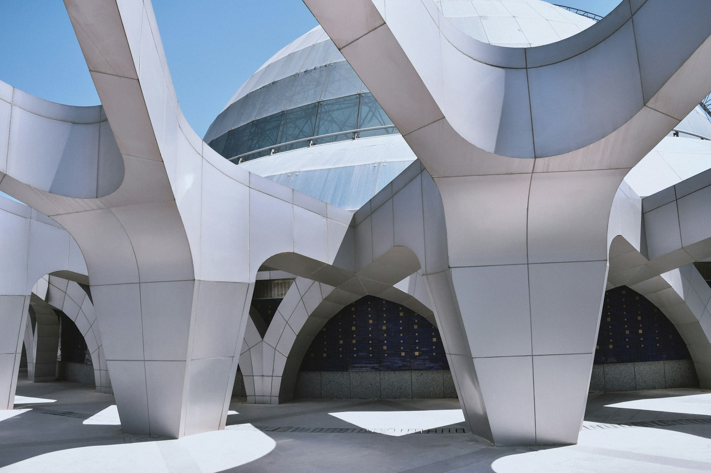

Every other material in a building can be upgraded later. You can replace a floor, reline a wall, change every light fitting, and swap the joinery. You cannot add daylight to a room that is twelve metres from a window with a 2.6 metre ceiling. That decision was made on a section drawing, possibly before the client had appointed an interior designer, and it is permanent.

This is why daylight belongs to the structural conversation and not the finishes one, and why it is so consistently lost.

## The three numbers that decide it

Daylight in a room is mostly governed by geometry, and the geometry reduces to three figures.

**Head height of the glazing.** Not the sill — the top. Light penetrates roughly two to two and a half times the height of the window head above the floor. A window head at 2.2 metres gives you useful light to about five metres in. Raise the head to 3.0 metres and you reach seven. The sill height changes the view; the head height changes the room.

**Room depth.** Beyond that penetration limit you are in permanent artificial light regardless of how much glass you install. A deep plan with a fully glazed facade is not a daylit building; it is a bright band and a dim interior, which is worse than an evenly lit one because the contrast makes the back of the room feel darker than it measures.

**Surface reflectance.** A ceiling at 0.8 reflectance versus 0.6 is worth roughly a metre of penetration, free. This is the only one of the three that a fit-out can still fix, which is why it is the one most often relied on to rescue a plan that was already too deep.

## Two windows beat one big one

A room with glazing on a single wall has a light gradient and a glare source. The same total area split across two walls produces something qualitatively different: modelling. Surfaces get a light side and a shadow side, and the room stops reading as flat.

This is the reason perimeter-lit cellular offices from the 1930s often feel better than open plans with four times the glazing. It is also the strongest argument for narrow plan depths in housing, where dual aspect is the difference between a flat that people stay in and one they leave after two years.

_Photo: [Foad Roshan](https://unsplash.com/photos/white-concrete-building-under-blue-sky-during-daytime-JjDQeWWCbpI) — openings placed rather than distributed, and a wall left to do the rest._

Top light is the exception that proves the rule. A roof slot delivers light evenly across a plan of any depth, with no view and no glare from low sun. It only works on the top floor, which is why it belongs to galleries, workshops, and the best rooms in most schools.

## What blinds tell you

The most useful daylight audit in existence takes ten minutes and no equipment: walk past the building at three in the afternoon and count the blinds that are down.

If most of them are down, the facade has failed, whatever the model said. Occupants lower a blind for glare, not for heat, and once it is down it usually stays down for days — at which point the building is running on artificial light behind a shaded window, paying the cooling penalty for the glass and getting none of the benefit.

The fix is almost always external and almost always cut: a projecting reveal, a fixed brise-soleil, a deeper mullion on the west elevation. Internal blinds are a control, not a solution. They stop glare by stopping daylight.

## Where the money actually goes

A lighting designer can do remarkable work with a modest budget, and good artificial light in a poorly daylit room is a genuine improvement. But the running comparison is unfair to the electricians. Daylight is free at the point of use, varies through the day in a way that people demonstrably prefer, and needs no maintenance contract.

Its cost is paid once, in plan and section: a shallower building, a taller floor-to-floor, a courtyard where a floorplate could have gone, a roof light where plant would have been cheaper.

Those are expensive decisions and they are made early, by people who will never be in the room. That is the whole problem, and no amount of specification later in the job can undo it.
